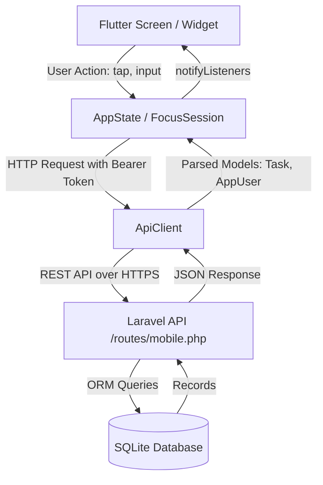

# 🏛️ WorkMind Project Structure & Developer Architecture Guide

This document provides a clear, comprehensive guide to the codebase architecture for developers working on the **WorkMind** project (Laravel Web/API + Flutter Mobile monorepo).

---

## 📌 Repository Overview

The repository is organized as a unified full-stack monorepo:

```
Task-Manager/
├── app/                  # Laravel 11 Backend Core (Controllers, Models, Services)
├── bootstrap/            # Application Bootstrap & Configuration
├── config/               # Laravel Configuration Files
├── database/             # Migrations, Seeders, SQLite Database
├── docs/                 # Documentation (Architecture, Vercel Deployment)
├── mobile/               # Flutter Android/iOS Mobile Application
├── public/               # Web Entrypoint & Compiled Assets
├── resources/            # Blade Views, Tailwind CSS, Frontend JavaScript
├── routes/               # Route Definitions (web.php, mobile.php, api.php)
├── storage/              # Logs, Cache, Framework Storage
├── tests/                # Laravel Feature & Unit Tests
├── tools/                # Deployment Scripts & Verifiers
├── artisan               # Laravel CLI Entrypoint
├── composer.json         # PHP Dependencies
├── package.json          # Node.js Dependencies (Vite, Tailwind)
└── vercel.json           # Vercel Serverless Deployment Configuration
```

---

## 📱 Flutter Mobile Architecture (`mobile/`)

The mobile application follows a **Clean Layered Architecture** with distinct responsibilities for Presentation, State Management, Data Services, and Domain Models.

### Directory Tree

```
mobile/lib/
├── main.dart                      # Flutter Entrypoint (Bindings, Dependency Injection)
└── src/
    ├── app.dart                   # Global MaterialApp, Theming & Base Navigation
    │
    ├── models/                    # 📦 DOMAIN & DATA MODELS
    │   └── models.dart            # AppUser, Task, Subtask, Status Helpers, Date Formats
    │
    ├── services/                  # 🌐 DATA & NETWORK SERVICES
    │   └── api.dart               # ApiClient, ApiException, SessionStore, SecureSessionStore
    │
    ├── state/                     # ⚡ STATE MANAGEMENT (ChangeNotifiers & Controllers)
    │   ├── app_state.dart         # Global AppState (Auth, Task Cache, Mutations, Sync)
    │   ├── focus_session.dart     # Focus session synchronization & storage persistence
    │   └── focus_timer.dart       # Pomodoro timer engine, Flow State stopwatch & presets
    │
    ├── screens/                   # 🖥️ PAGE VIEWS (UI Screens)
    │   ├── analytics_view.dart    # Productivity metrics, completion charts & statistics
    │   ├── auth_screen.dart       # Sign In & Registration forms
    │   ├── focus_view.dart        # Deep Work Focus Session, Target Task, Brain Dump & Zen Mode
    │   ├── home_shell.dart        # Navigation shell (Bottom Navigation Bar, Tab Routing)
    │   ├── onboarding_screen.dart # Interactive first-run walkthrough (Features & Value)
    │   └── task_editor.dart       # Task creation & editing modal/screen
    │
    └── widgets/                   # 🧩 REUSABLE UI COMPONENTS
        ├── animated_taskbar.dart  # Floating navigation bar with smooth animations
        ├── motion.dart            # Standard animation curves & accessibility motion gates
        ├── task_card.dart         # Swipeable task item card with priority badges & checklist
        └── task_clipboard_graphic.dart # Custom painter / illustrations
```

### Layer Responsibilities

| Layer | Directory | Purpose & Rules |
| :--- | :--- | :--- |
| **Models** | `lib/src/models/` | Immutable data transfer objects (DTOs), JSON serialization (`fromJson` / `toPayload`), and pure helper functions (`statusLabel`, `dateOnly`). No Flutter UI imports. |
| **Services** | `lib/src/services/` | Network requests (`ApiClient`), error handling (`ApiException`), and device storage (`SecureSessionStore`). Handles base URLs, token authentication headers, and timeout guards. |
| **State** | `lib/src/state/` | Extends `ChangeNotifier`. Manages in-memory cache, background synchronization, mutation queues, and business logic. Notifies listening UI widgets. |
| **Screens** | `lib/src/screens/` | Top-level view widgets bound to `AppState`. Responsible for user interaction, layout scaffolding, and invoking state methods. |
| **Widgets** | `lib/src/widgets/` | Stateless or localized stateful UI components that are shared across multiple screens. Highly reusable and decoupled from global state where possible. |

---

## ⚡ State Flow & Data Flow Architecture

The data lifecycle between Flutter and Laravel follows a unidirectional and reactive cycle:



---

## 💻 Laravel Backend Architecture (`app/`)

The backend is built with **Laravel 11**, using modern controllers and service layers:

```
app/
├── Http/
│   ├── Controllers/
│   │   ├── Api/
│   │   │   ├── MobileAuthController.php   # /api/mobile/login, /register, /me, /logout
│   │   │   └── TaskApiController.php     # /api/mobile/tasks, /dashboard, /calendar
│   │   ├── Auth/                          # Web authentication controllers
│   │   ├── AiCopilotController.php        # Nova AI Copilot assistant web endpoint
│   │   └── TaskController.php             # Web Blade task CRUD controller
│   └── Middleware/
│       └── SecurityHeaders.php            # HTTP Security & CORS headers
├── Models/
│   ├── Task.php                           # Task entity (checklist, priority, dates)
│   ├── User.php                           # User entity (Sanctum tokens, relationships)
│   └── AiChatMessage.php                  # Persisted Nova AI conversation history
├── Services/
│   └── AiTaskCopilotService.php           # AI Copilot logic (Gemini API + local heuristic fallback)
└── Notifications/
    └── AiTaskCreatedNotification.php      # User notification triggers
```

### Route Separation

- **`routes/web.php`**: Server-side rendered Blade views (Dashboard, Kanban, Calendar, Task Detail, Profile).
- **`routes/mobile.php`**: Dedicated Mobile API endpoints prefixed with `/api/mobile`, protected by Laravel Sanctum.
- **`routes/api.php`**: General API endpoints.

---

## 🛠️ Developer Workflow & Guidelines

### Where to add new code?

1. **Adding a new data field to Tasks**:
   - Backend: Add database migration in `database/migrations/` and update `app/Models/Task.php` fillable.
   - API: Update resource/json payload in `app/Http/Controllers/Api/TaskApiController.php`.
   - Mobile: Update `mobile/lib/src/models/models.dart` (`Task` constructor, `fromJson`, `toPayload`).

2. **Adding a new Mobile Screen**:
   - Create screen in `mobile/lib/src/screens/<feature>_view.dart`.
   - Add tab/route in `mobile/lib/src/screens/home_shell.dart` or `app.dart`.
   - If reusable UI widgets are needed, place them in `mobile/lib/src/widgets/`.

3. **Adding a new Mobile State or Service**:
   - Network / Storage service -> `mobile/lib/src/services/`.
   - State controller / ChangeNotifier -> `mobile/lib/src/state/`.

### Quality & Static Analysis Checks

Before committing changes:

```powershell
# In mobile/ directory
flutter analyze
flutter test

# In root directory (Laravel)
composer test
vendor/bin/pint --test
```
